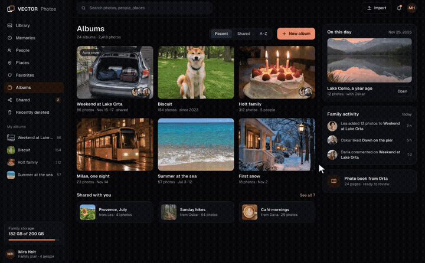

# Album Cover

**Our lake trip album opened on a photo of the car trunk.**



**Live demo:** [veraetogrex-portfolio.github.io/album-cover](https://veraetogrex-portfolio.github.io/album-cover/) · **Mockup:** [full-screen version](https://veraetogrex-portfolio.github.io/album-cover/mockup/album-cover.html)

A family photo album screen: drag a photo from Highlights onto the cover and it unfolds into the full-width header; the sidebar thumbnail and the family's preview follow, Undo brings the auto cover back. Vanilla HTML/CSS/JS, zero dependencies.

## Try it

- Open "Weekend at Lake Orta" from the album grid or the sidebar. The album opens on its auto cover, the first photo of the trip (a car trunk), labelled "Auto cover · first photo".
- Drag "Dawn on the pier" from Highlights up to the cover. The cover darkens with a coral dashed edge and "Drop to make it the cover", and a dashed "Moving to cover" gap stays in the slot. Drop it anywhere else and it slides back.
- Drop it on the cover. The photo unfolds from the card into the full-width header in 0.8 s: "Cover · chosen by you", "New cover for the family · Undo" and a Cover badge on the photo in Highlights. All photos still starts with the trunk.
- A moment later the sidebar thumbnail and "What they see in their albums" show the new cover ("New cover · updated just now"), and Activity adds "You set Dawn on the pier as the cover".
- Press Undo. The auto cover comes back everywhere.
- Keyboard: Tab to a photo in Highlights, Enter or Space makes it the cover.

## Use it

Three files and the photos, no build step, no dependencies:

```
index.html   markup
style.css    styles
script.js    logic
assets/      the photos (generated, free to reuse with the code)
```

Download the repo and open `index.html`, or copy the files into your project. Set `data-assets` on `<section class="ac">` to the folder with your photos.

## License

MIT
